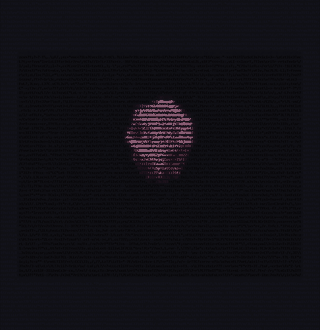

<div align="right"><a href="README.en.md">English</a> · <a href="README.md">Русский</a></div>

# Pavel's ASCII Gallery

## Gallery

<table>
  <tr>
    <td width="50%" valign="top">
      <h3>Bloom</h3>
      <p>A flower opens and scatters into glowing characters.</p>
      
      <p><a href="artworks/bloom/main.py">Source</a></p>
    </td>
    <td width="50%" valign="top">
      <h3>Butterfly</h3>
      <p>A butterfly takes flight from its chrysalis.</p>
      
      <p><a href="artworks/butterfly/main.py">Source</a></p>
    </td>
  </tr>
  <tr>
    <td width="50%" valign="top">
      <h3>Blackhole</h3>
      <p>A character-built galaxy collapses into a black hole.</p>
      
      <p><a href="artworks/blackhole/blackhole.py">Source</a></p>
    </td>
    <td width="50%" valign="top">
      <h3>Eye</h3>
      <p>A symbol-built eye blinks and draws the scene into its pupil.</p>
      
      <p><a href="artworks/eye/eye.py">Source</a></p>
    </td>
  </tr>
</table>

## Excalibur

<table>
  <tr>
    <td width="50%" valign="top">
      
    </td>
    <td width="50%" valign="middle">
      <p>A video clip rendered as ASCII art.</p>
      <p>FFmpeg and FFprobe are required for your own clips.</p>
      <p><a href="artworks/excalibur/excalibur.py">Source</a></p>
    </td>
  </tr>
</table>

## Install and run

Requires Python 3.10 or newer.

### Windows · PowerShell

```powershell
python -m venv .venv
& .\.venv\Scripts\python.exe -m pip install -r requirements.txt
& .\.venv\Scripts\python.exe .\artworks\bloom\main.py
```

### macOS · Linux

```bash
python3 -m venv .venv
.venv/bin/python -m pip install -r requirements.txt
.venv/bin/python artworks/bloom/main.py
```

To run another piece, replace `artworks/bloom/main.py` with its script path.
