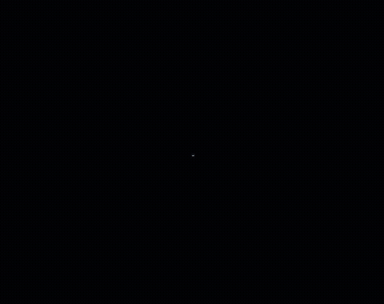

<div align="center">

# PAVELCRG · ASCII ART

Две анимации, где символы складываются в живые сцены.

[Смотреть работы](#работы) · [Запустить](#запуск) · [Авторство](#авторство-и-лицензия)

</div>

---

## Работы

### 01 — Bloom

Цветок раскрывается и разлетается на частицы.


[Исходный код](artworks/bloom/main.py)

### 02 — Butterfly

Кокон трескается, и из него вылетает бабочка.



[Исходный код](artworks/butterfly/main.py)

## Запуск

Нужен Python 3.10 или новее. Из корня репозитория создай окружение и установи общие зависимости:

```bash
python -m venv .venv
```

Windows PowerShell:

```powershell
.venv\Scripts\Activate.ps1
```

macOS / Linux:

```bash
source .venv/bin/activate
```

Затем из корня:

```bash
python -m pip install -r requirements.txt
```

Запускай каждую работу из её папки, чтобы записанные кадры оставались рядом с кодом.

```bash
cd artworks/bloom
python main.py
```

Или:

```bash
cd artworks/butterfly
python main.py
```

Пробел запускает анимацию заново, `Esc` закрывает окно. Вид символов немного зависит от моноширинного шрифта системы.

## Авторство и лицензия

Галерею Pavelcrg и её оформление собрал Pavelcrg. Bloom и Butterfly, включая их исходный код, — оригинальные работы **Edward Jones (@edjonesv)** из [его репозитория](https://github.com/edwardjones7/ascii-art) (commit `4e098f4`).

Обе работы распространяются по MIT. В [LICENSE](LICENSE) сохранено уведомление Edward Jones; отдельное уведомление Pavelcrg относится только к оформлению галереи и этому README.
