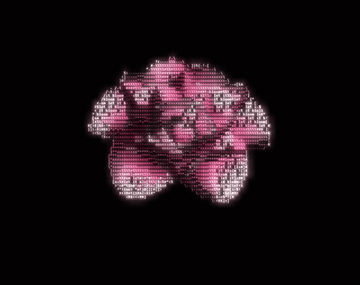
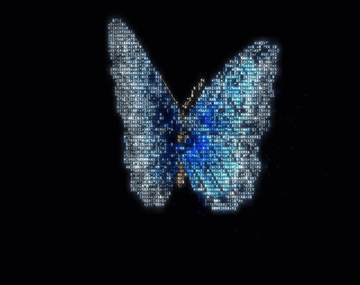
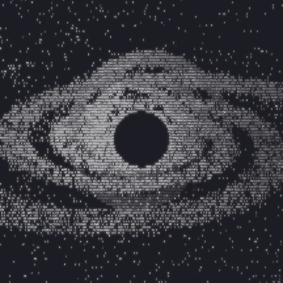
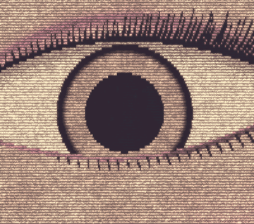

<div align="center">

# ASCII Art Gallery

**Small worlds, drawn one character at a time.**

[English](README.md) · [Русский](README.ru.md)

</div>

---

## Gallery

Click a still image to watch its animation.

<table>
  <tr>
    <td width="50%" valign="top">
      <h3>Bloom</h3>
      <a href="artworks/bloom/preview.gif"></a>
      <p>A flower opens and scatters into glowing fragments.</p>
      <a href="artworks/bloom/preview.gif">▶ Animation</a> · <a href="artworks/bloom/main.py">Source</a>
    </td>
    <td width="50%" valign="top">
      <h3>Butterfly</h3>
      <a href="artworks/butterfly/preview.gif"></a>
      <p>A chrysalis cracks open, and a butterfly takes flight.</p>
      <a href="artworks/butterfly/preview.gif">▶ Animation</a> · <a href="artworks/butterfly/main.py">Source</a>
    </td>
  </tr>
  <tr>
    <td width="50%" valign="top">
      <h3>Blackhole</h3>
      <a href="artworks/blackhole/preview.gif"></a>
      <p>A character-built galaxy folds into a black hole.</p>
      <a href="artworks/blackhole/preview.gif">▶ Animation</a> · <a href="artworks/blackhole/blackhole.py">Source</a>
    </td>
    <td width="50%" valign="top">
      <h3>Eye</h3>
      <a href="artworks/eye/preview.gif"></a>
      <p>A watchful eye blinks and pulls the scene into its pupil.</p>
      <a href="artworks/eye/preview.gif">▶ Animation</a> · <a href="artworks/eye/eye.py">Source</a>
    </td>
  </tr>
</table>

## Tool

**Excalibur** turns a video clip you provide into ASCII animation. It requires FFmpeg and FFprobe; no sample clip is included.

[Source code](artworks/excalibur/excalibur.py)

## Quick start

Requires Python 3.10 or newer. Create a project environment, install its dependencies, then run Bloom from the repository root.

### Windows · PowerShell

```powershell
python -m venv .venv
& .\.venv\Scripts\python.exe -m pip install -r requirements.txt
& .\.venv\Scripts\python.exe .\artworks\bloom\main.py
```

### macOS · Linux

```bash
python3 -m venv .venv
.venv/bin/python -m pip install -r requirements.txt
.venv/bin/python artworks/bloom/main.py
```

Use the `.venv` interpreter for every run; it contains NumPy and the other project dependencies. To launch another piece, replace the final path with its script: `artworks/butterfly/main.py`, `artworks/blackhole/blackhole.py`, or `artworks/eye/eye.py`.

Eye opens an animation window. Blackhole can export a video with `blackhole.py --export blackhole.mp4 --plain`. Excalibur accepts a video path, for example `excalibur.py clip.mp4 --export result.mp4 --to 10`; it needs FFmpeg and FFprobe.

## Credits & license

Bloom and Butterfly, including their original code and artwork, are by [Edward Jones (@edjonesv)](https://github.com/edwardjones7/ascii-art) (commit `4e098f4`). The original MIT license notice is preserved in [LICENSE](LICENSE).
