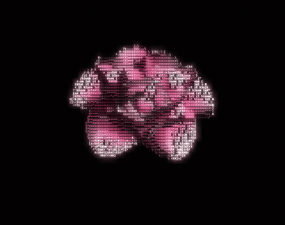
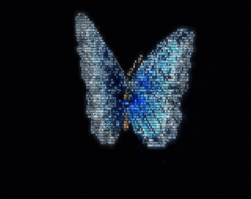
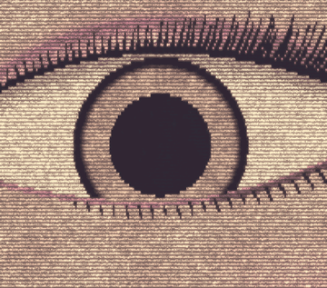

<div align="center">

# ASCII-галерея

**Маленькие миры, нарисованные символами.**

[English](README.md) · [Русский](README.ru.md)

</div>

---

## Галерея

Нажми на изображение, чтобы открыть анимацию.

<table>
  <tr>
    <td width="50%" valign="top">
      <h3>Bloom</h3>
      <a href="artworks/bloom/preview.gif"></a>
      <p>Цветок раскрывается и рассыпается на светящиеся частицы.</p>
      <a href="artworks/bloom/preview.gif">▶ Анимация</a> · <a href="artworks/bloom/main.py">Код</a>
    </td>
    <td width="50%" valign="top">
      <h3>Butterfly</h3>
      <a href="artworks/butterfly/preview.gif"></a>
      <p>Кокон раскрывается, и бабочка отправляется в полёт.</p>
      <a href="artworks/butterfly/preview.gif">▶ Анимация</a> · <a href="artworks/butterfly/main.py">Код</a>
    </td>
  </tr>
  <tr>
    <td width="50%" valign="top">
      <h3>Blackhole</h3>
      <a href="artworks/blackhole/preview.gif"></a>
      <p>Галактика из символов сжимается в чёрную дыру.</p>
      <a href="artworks/blackhole/preview.gif">▶ Анимация</a> · <a href="artworks/blackhole/blackhole.py">Код</a>
    </td>
    <td width="50%" valign="top">
      <h3>Eye</h3>
      <a href="artworks/eye/preview.gif"></a>
      <p>Внимательный глаз моргает и затягивает сцену в зрачок.</p>
      <a href="artworks/eye/preview.gif">▶ Анимация</a> · <a href="artworks/eye/eye.py">Код</a>
    </td>
  </tr>
</table>

## Инструмент

**Excalibur** превращает выбранный видеофрагмент в ASCII-анимацию. Нужны FFmpeg и FFprobe; примера видео в проекте нет.

[Исходный код](artworks/excalibur/excalibur.py)

## Быстрый запуск

Нужен Python 3.10 или новее. Создай окружение проекта, установи зависимости и запусти Bloom из корневой папки репозитория.

### Windows · PowerShell

```powershell
python -m venv .venv
& .\.venv\Scripts\python.exe -m pip install -r requirements.txt
& .\.venv\Scripts\python.exe .\artworks\bloom\main.py
```

### macOS · Linux

```bash
python3 -m venv .venv
.venv/bin/python -m pip install -r requirements.txt
.venv/bin/python artworks/bloom/main.py
```

Для запуска всегда используй Python из `.venv`: в этом окружении установлены NumPy и остальные зависимости проекта. Чтобы запустить другую работу, замени последний путь на её скрипт: `artworks/butterfly/main.py`, `artworks/blackhole/blackhole.py` или `artworks/eye/eye.py`.

Eye открывает окно с анимацией. Blackhole умеет сохранять видео командой `blackhole.py --export blackhole.mp4 --plain`. Excalibur принимает путь к видео, например `excalibur.py clip.mp4 --export result.mp4 --to 10`; ему также нужны FFmpeg и FFprobe.

## Авторство и лицензия

Bloom и Butterfly, включая оригинальный код и изображения, создал [Edward Jones (@edjonesv)](https://github.com/edwardjones7/ascii-art) (commit `4e098f4`). Оригинальное уведомление о лицензии MIT сохранено в [LICENSE](LICENSE).
